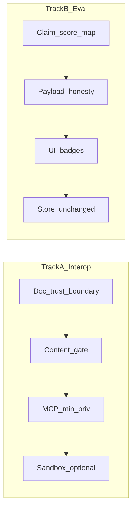

# 外源互通 × 评价体系信任硬化优化方案

> **设计目标态。** 实施按切片开 PR；两轨禁止混门禁。  
> **非**知识系统 Phase 2 sufficient-freeze / Nxx certified 必做项。  
> 依据：对 SecureScan / `compute_*_compat` / enable 与评测双 composite / claim / store 的代码核对结论。

## 0. 一句话

两边都在「诚实锁」上做对了，但**绿灯语义过载**：外源「能调度」被听成「已安全」；评测「有分数 / scoped claim」被听成「准确率已认证」。优化 = **钉死信任边界 → 补齐与承诺匹配的门禁 → 再谈沙箱/拆分**。

## 0.1 总原则

| # | 原则 | 说明 |
|---|------|------|
| 1 | 分轨 | Track A（外源）与 Track B（评测）独立 PR / 独立验收；禁止捆绑 |
| 2 | 诚实优于假绿 | 新能力缺省 fail-closed；做不到写 `declared_unavailable` / report-only |
| 3 | 承诺对齐 | 「导入即可用」「connected」「composite」各自写清能证明什么 |
| 4 | 成本阶梯 | 文档/契约 → 启发式与策略门 → 可选沙箱 / store 全量 / composite_profile |
| 5 | 不恢复 deepen mop | 不借本方案重开 KS 默认 deepen 或置 `certified` |



---

# Track A — 外源资产互通安全硬化

## A.1 权威与锚点

| 类型 | 路径 |
|------|------|
| 方案 | [`external-asset-interop-compat-tiers.md`](./external-asset-interop-compat-tiers.md) |
| SecureScan | `aiPlat-core/core/harness/maintenance/asset_secure_scan.py` |
| 弱内容扫描 | `aiPlat-core/core/harness/maintenance/skill_boundary.py` |
| Compat | `aiPlat-core/core/harness/maintenance/asset_compat.py` |
| 安装 | `aiPlat-core/core/management/skill_installer.py` / `asset_installer.py` |
| Enable | `enable_handler_draft` / `dry_run_handler_draft`（同 `asset_compat`） |

## A.2 已核实问题（优化输入）

1. SecureScan 不做指令/语义扫描；「默认可用」最宽路径与 SecureScan 能力不匹配。另有弱正则 `scan_skill_dir`，挡不住软指令工具滥用。
2. 启用后第三方 handler **无沙箱**；方案未声明；PolicyGate ≠ 代码审查。
3. MCP「最小权限 / 高风险」未形式化；工具描述注入未提。
4. P6 依赖语义大半空白（Agent 有部分 required_skills）。
5. `prompt_ready` 含「已有 handler.py」分支，命名不准。

## A.3 切片

### A-P0 — 信任边界写进方案（必做·先合）

在 `external-asset-interop-compat-tiers.md` 增加 **§2.1 信任边界**，并修订 §9 非目标。验收句（须可 grep）：

1. 说明书型 Skill 默认可调度 **≠** 内容安全已认证；SecureScan alone 不够。
2. 启用后的第三方 `handler.py` / tool 实现：**无运行时沙箱**，以工作区用户身份与已授权工具集执行；PolicyGate 只决定能否调用该资产，不审查 handler 体内逻辑。
3. §5.4 试跑仅静态 compile + 签名/`TOOL_DEF`，**不** exec 草稿；启用转正后才正式调度。
4. MCP `connected` 绿灯 **≠** 最小权限已形式化验证；描述注入为已知残差（A-P2）。

可选：升格页 / InstallReport 脚注链到 §2.1。系统契约一条短 `clause-sync`（不改 run_id 语义）。

**不做**：改 SecureScan 职责边界（仍只管包结构）。

### A-P1 — 导入期指令内容门（对齐「默认可用」）

**职责分离**：

| 门 | 职责 |
|----|------|
| SecureScan | 路径穿越 / 危险后缀 / zip 炸弹（保持） |
| ContentGate（新建或扩展 skill_boundary） | SKILL.md + 邻近文本的对抗性/工具滥用启发式 |

接线：`SkillInstaller` / 相关 adapt 路径在 Persist 前调用；与现有 `scan_skill_dir` **合流**（一套结果，禁止双标准）。

结果写入 `_compat.issues` + InstallReport：

| 级别 | 行为 |
|------|------|
| `block` | 拒装或 `tier=blocked` / `schedulable=false` |
| `degrade` | 可装但不可默认可调度（「还差几步」） |
| `warn` | 可调度，issues 可见 |

**规则 v0（诚实：非语义完备）**：扩展现有 `_HOSTILE`；增加「高危工具共现 / 批量外传 / 凭证外送」等可配置词表（**禁止**硬编码业务 agent 名）。Non-goals：不做 LLM-as-judge；不宣称防尽 prompt injection。

**验收**：

- 恶意说明书 fixture → block 或不可调度。
- 良性说明书 → 仍可 `prompt_ready` 调度。
- `test_asset_secure_scan.py` 不回归；新增 `test_asset_content_gate.py`。

### A-P2 — MCP 最小权限契约 + 描述不受信

在方案 §3 MCP 下钉死（推荐默认，实施时二选一写死）：

**推荐默认（偏安全）**：连接成功后 allowlist **为空则零业务工具可调**；须显式确认工具集或导入策略后才 `schedulable` 开放；UI「还差几步：确认工具」。若与「马上能用」冲突，以诚实三态降级，禁止假绿。

**备选（偏体验）**：无注解工具全部 `gated`；仅明确只读注解可进默认 allowlist。

高风险识别优先级：① `policy.yaml` / `tool_risk`（已有）② 服务端注解 ③ 名称启发式 warn ④ **禁止**「已连接 = 全开」。

描述注入 v0：文档声明 description 为不受信输入；进入 LLM 前平台包装前缀 + 长度截断；`_compat.issues` 增加 `mcp_tool_descriptions_untrusted`。

**验收**：空 allowlist 不可随意工具调用；gated 确认流不回归；文档含「最小权限」定义句。

### A-P3 — Skill tier / 执行面语义

任选其一（推荐 1）：

1. `prompt_ready` 仅无 `handler.py`；有 handler 且可调度 → `handler_ready`（新 tier）。
2. 或增加 `execution_surface: prompt|handler|tools`，tier 名暂不动。

**验收**：带 handler 的 fixture UI/报告不再仅呈现「纯说明书」语义。

### A-P4 — 启用后沙箱（可选·后置）

仅当「第三方 handler 可上生产」成为产品门禁时立项。候选：复用评测 Runner 沙箱契约 / subprocess + FS·网络 allowlist。  
**首期不交付**；靠 A-P0 声明边界。

### A-P5 — P6 依赖语义 v0（可选）

- `dependencies.required` 列表；缺失 → Agent `needs_binding` / Skill issues。
- v0 **无**版本范围；环 → `blocked`。
- Tool/MCP 空 `dependencies` 仍合法。

---

# Track B — 评价体系口径与可用性

## B.1 权威与锚点

| 类型 | 路径 |
|------|------|
| 信任边界 | [`eval-trust-boundary-lab-vs-cert.md`](./eval-trust-boundary-lab-vs-cert.md) |
| 工程 composite | `packages/aiplat-evaluation/app/scoring/composite.py`（`build_composite` + family 重归一化） |
| 双路径冻结 | ARCH clause 77；`P1_CANONICAL` / `PRODUCT_ROOT_V1` |
| Store 诚实子集 | `packages/aiplat-evaluation/docs/a3/STORE_SURFACE_V0.md` |

## B.2 已核实问题（优化输入）

1. `legacy_7dim` ∥ `build_composite` 永久并存（诚实冻结，跨路径不可比）。
2. family 重归一化 → composite 不天然跨对象排名（文档已承认）。
3. schema 8 实体 vs standalone 子集（已 STORE_SURFACE 标注）。
4. scoped G2b claim ≠ product `accuracy_claim`，话术分散易误读。

## B.3 切片

### B-P0 — 口径地图单页 SSOT（必做）

新建 `packages/aiplat-evaluation/docs/a3/SCORING_AND_CLAIM_MAP.md`（名称可微调），作为**唯一对外引用入口**：

| 对象 | 可用于 | 不可用于 |
|------|--------|----------|
| `build_composite` | 工程回归、同配置 A/B | 准确率认证；family 覆盖不同时的横向排名 |
| `legacy_7dim` | 历史对照 report-only | 工程门禁、对外准确率 |
| scoped G2b claim | 限定 benchmark 声明 | 产品级 accuracy / 安全认证 |
| product `accuracy_claim` | 仅显式升级后 | 默认 false |

强制：展示 composite 时同时展示 `weights_used` + 有数据的 family（字段已由 `build_composite` 返回）。

### B-P1 — API / 序列化诚实载荷

对外 report 必须含：`scoring.path` ∈ `{package_build_composite, legacy_7dim}`、`accuracy_claim`、`composite.weights_used`、`composite.family_scores`。  
UI：legacy 路径徽章「历史口径·非工程」。

### B-P2 — Claim 升级条件表

在口径地图用表钉死 scoped → product 的 AND 门（引用 G2b 现有数字与 attestation，**禁止**另抄冲突数）。  
一句话验收：**scoped true 时 product 仍 false，直到显式升级。**  
与 `g2b_claim_unlock_checklist` Facade 字段对齐。

### B-P3 — 双 composite 终态策略（决策，不删代码）

- 保留双路径；新门禁只认 package composite。
- UI 默认隐藏 legacy；API 仅 `scoring=legacy` 显式返回。
- **禁止**把 legacy 权重改成 package（违反 clause 77）。

### B-P4 — Store 表面

A3 未授权前禁止 standalone 假全量 8 实体 CRUD；维持 `STORE_SURFACE_V0`。全量 parity 单独立项。

### B-P5 — composite 可比性（可选）

引入 `composite_profile_id`（固定 family 集；缺维 → `incomplete` 而非 silently 重归一化当「完整分」），或排名 API 拒绝 coverage 不同的对象。新 `composite_version` 才允许改公式。

---

# 交付顺序与 PR 切分

| 切片 | 内容 | 体量 | 依赖 |
|------|------|:----:|------|
| **S1** | A-P0 + B-P0 文档 | 小 | 无 |
| **S2** | A-P1 内容门 + 测试 | 中 | S1 建议先合 |
| **S3** | A-P2 MCP 最小权限 | 中 | S1 · **已合入 PR #1029** |
| **S4** | B-P1 + B-P2 载荷/UI/claim 表 | 中 | S1 |
| **S5** | A-P3 tier 语义 | 小 | S2 可并行 |
| **S6+** | A-P4/P5 · B-P3/P5 | 大 | 产品显式点名 · **薄切片已合**：A-P5 deps + A-P4 `declared_unavailable` + B-P3 gate helper + B-P5 `composite_profile_id`；**未宣称** 生产沙箱完备 / Full |

**默认并行**：`S1` 后开 **S2∥S4**，再 **S3**，然后 **S5**。

每 PR：独立缺陷门禁 → `python3 scripts/defect_gate_validate.py` → 非作者 Approve 再合。

---

# 验证总闸

```bash
# Track A
PYTHONPATH=aiPlat-platform:aiPlat-core:aiPlat-infra .venv/bin/python -m pytest \
  aiPlat-core/core/tests/unit/test_tools/test_asset_secure_scan.py \
  aiPlat-core/core/tests/unit/test_tools/test_asset_compat_phase_a.py \
  aiPlat-core/core/tests/unit/test_tools/test_asset_compat_phase_c.py -q
# + test_asset_content_gate.py / mcp min-priv（S2/S3 落地后）

# Track B
bash packages/aiplat-evaluation/scripts/p1_canonical_gate.sh
# + report 字段断言；口径地图链接检查
```

文档声明可验证性：凡「已实现 X」须附 grep/pytest 证据（工作区文档规则）。

---

# 明确不做（首期）

| 不做 | 原因 |
|------|------|
| 宣称内容门 = 语义防注入完备 | 启发式诚实边界 |
| 宣称 handler 已沙箱 | A-P4 未做 |
| 宣称 MCP 最小权限已形式化证明 | A-P2 契约落地前禁止 |
| 合并/重加权 legacy_7dim 进工程分 | clause 77 |
| 静默 product `accuracy_claim=true` | 认证流程 |
| standalone store 假全量 | STORE_SURFACE |
| 捆绑 `$where` / 生产切写 / Nxx certified | 不同问题域 |

---

# 成功标准（首期 S1–S4）

1. 外源方案与评测口径地图均可被「安全/认证读者」读懂：绿灯各意味什么。
2. 至少一类「软指令恶意 Skill」在导入或调度前被挡或降级。
3. MCP 不再出现「connected + 空策略 = 全工具默认可调」的未定义状态（按 A-P2 钉死的默认）。
4. 对外 composite / claim 展示带 path、weights、scoped≠product 提示。
5. 无任何 PR 将上述改进表述为 Full unconditional / Nxx certified / 沙箱已完成。
