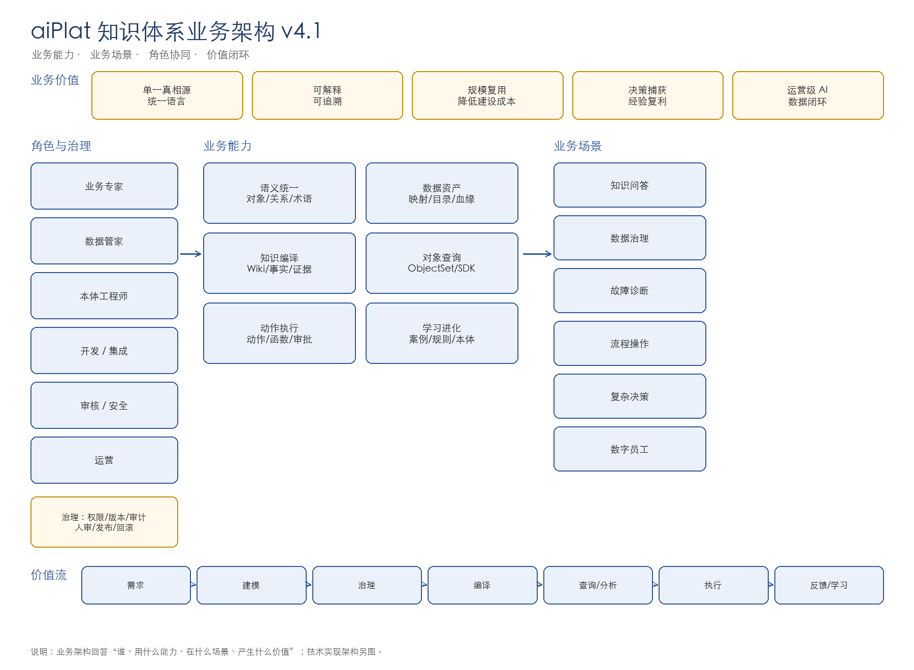
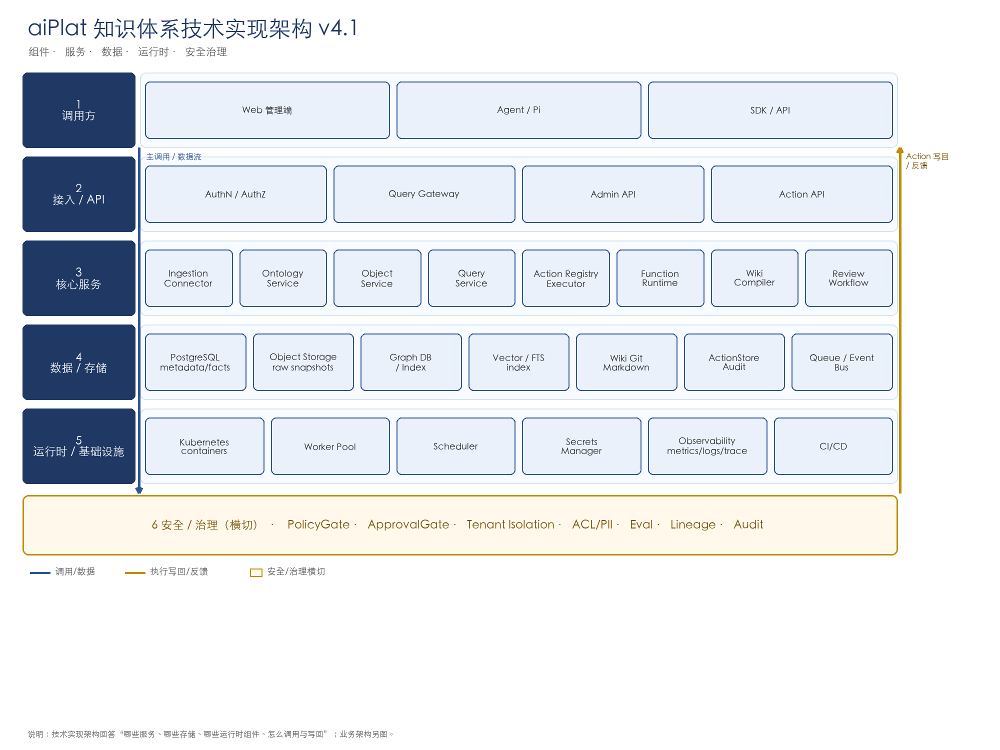
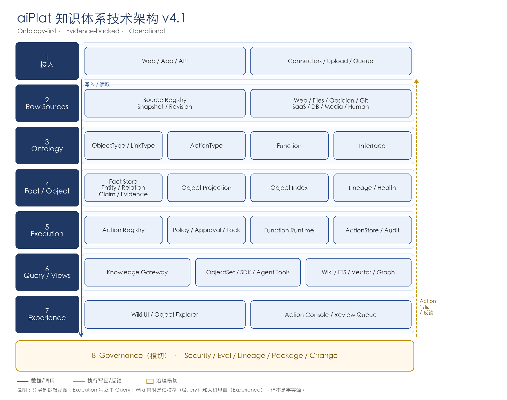

# aiPlat 知识体系技术白皮书 v4.1

> **版本**：v4.1 · 2026-11-11  
> **定位**：Ontology-first, Evidence-backed, Operational  
> **性质**：技术白皮书 / 目标架构规范  
> **状态**：Proposed；后续设计与实现以此为准，变更走 ADR  
> **说明**：本版把“七类痛点 + 三条闭环 + 八层架构”用更直白的语言讲清楚；正文不含 JSON/SQL。  
> **诚实边界**：不宣称“通用、无范围、无证据”的 RAG 准确率；允许范围限定、可复现的 benchmark 结论。不把 Wiki 当事实源，不以白皮书代替实现与验证。

---

## 文档地图

| 正文 | 内容 | 对应附录 |
|---|---|---|
| 0–1 | 一页概览、七类痛点 | — |
| 2 | 三条闭环 | — |
| 3 | 业务架构、技术实现架构、逻辑分层 | — |
| 4 | 真相模型、可重建、Raw 变化 | A/B/D |
| 5 | 写入、读取、执行 | A/C/D |
| 6 | 本体：对象/关系/动作/函数/接口/管理画面 | B/C |
| 7 | 事实/对象、对象索引、血缘、场景 | D |
| 8 | 执行层、Action/Function Runtime | C/G |
| 9 | 查询、ObjectSet、SDK、Agent 工具 | E/F |
| 10 | Wiki、对象浏览器、动作台、审核台 | F |
| 11 | 更新传播 | A/D/H |
| 12 | 安全与多租户 | H |
| 13 | 质量、评测、准确率声明 | I |
| 14–15 | 路线图、结论 | — |

> 阅读顺序：决策者读 0–3、13–15；架构师读全篇；工程师读 4–12 + 附录。

---

## 0. 先看一页：这套系统到底在做什么

很多知识系统的问题是：

> **资料收进来了，但用不起来；答得出来，但不一定准确；说得头头是道，但落不了地；做完了，但沉淀不下来。**

这里有两个不同的失败模式：

- **“答得出来，但不准确”**：事实/口径/证据有问题，属于“知识可信”问题；
- **“答得出来，但做不了”**：知道该怎么做，但不能安全地在业务系统里执行，属于“知识到行动”问题。

两者不是一回事，都要解决。

aiPlat 想做的是一条完整链路：

> **把资料收进来 → 变成业务对象和事实 → 能查、能推理 → 能安全地执行动作 → 把结果和案例再沉淀回本体。**

用一句大白话：

> **Raw 是“原件”，Ontology 是“业务地图”，Fact/Object 是“事实和对象”，Execution 是“真正去做”，Query 是“怎么查/怎么调”，Experience 是“人怎么用”，Governance 是“怎么保证不出事”。**

---

## 1. 七类痛点

### 1.1 语义不统一

同一客户、订单、产品，不同部门叫法不同；业务术语、数据字段、系统模型各说各话；业务与 IT 两张皮。

**结果**：数据对不上、口径吵不清、AI 答得看似合理但不可用。

### 1.2 数据与知识割裂

数据在库/表/API；知识在文档、提示词、FAQ、代码里；没有统一的对象层、数据映射和资产目录。

**结果**：每个新需求都重新做数据整合，知识无法复用。

### 1.3 知识与行动断裂

系统知道“该做什么”，但不能安全地做：缺动作、函数、SOP、审批、权限、审计。

**结果**：AI 只能问答，不能嵌入业务流程。

### 1.4 推理与洞察不足

只有关键词/向量检索，缺显式关系、隐性关系发现、一致性校验、模拟和决策。

**结果**：只能“找到相似内容”，不能“发现关系、判断影响、辅助决策”。

### 1.5 经验不沉淀、不自进化

案例、决策、反馈不回收；没有 `case → action → outcome → rule → ontology` 闭环。

**结果**：每次从零开始，组织经验无法复利。

### 1.6 答案不可信、治理不足

这条同时包含“答得准不准”和“敢不敢用”：

- 事实/口径不准，回答看似合理但不可验证；
- 无来源、无证据链；
- 无权限、无版本、无 owner、无审计；
- 无法解释、无法追责、无法规模化复用。

**结果**：Demo 很漂亮，生产不敢用；或者答得很快，但答错了。

### 1.7 建设成本高、难复用

每个需求重新集成；缺建模方法、工具、API、包和复用机制。

**结果**：没有规模经济，越做越重。

### 开头四句话，对应七类痛点

| 开头的失败模式 | 对应痛点 |
|---|---|
| 资料收进来了，但用不起来 | 1 语义不统一、2 数据/知识割裂、7 成本高 |
| 答得出来，但不一定准确 | 6 答案不可信 |
| 说得头头是道，但落不了地 | 3 知识/行动断裂、4 推理/洞察不足 |
| 做完了，但沉淀不下来 | 5 经验不沉淀 |

> 原来的“四个痛点”只覆盖了第 1、3、5、6 条的一部分；完整版应覆盖七条。

---

## 2. 三条闭环

八层架构解决“系统怎么分层”；三条闭环解决“系统怎么越用越聪明”。

### 2.1 语义治理闭环

> 数据/术语 → 本体 → 校验 → 数据资产目录 → 再治理

- 统一业务语言；
- 统一对象/属性/关系；
- 数据映射、血缘、质量；
- 本体不是 IT 私产，是业务与 IT 的契约。

### 2.2 推理决策闭环

> 本体 → 推理/校验 → 决策/模拟 → 动作 → 结果

- 显式关系、隐性关系；
- 一致性检查；
- what-if / dry-run；
- 决策理由可追溯。

### 2.3 学习进化闭环

> 动作 → 结果 → 案例 → 规则 → 本体

- 成功/失败案例都入库；
- 案例检索与推荐；
- 人审后更新规则/本体；
- 不自动改本体，避免自证。

---

## 3. 八层架构（大白话版）

| 层 | 一句话 | 里面有什么 |
|---|---|---|
| **1 接入** | 把资料接进来 | API、连接器、上传、队列 |
| **2 原始** | 原样保存，不改原文 | 网页、文件、Obsidian、Git、SaaS、数据库、图片/音视频、人工材料 |
| **3 本体** | 给业务世界画地图 | 对象、关系、动作、函数、接口；定义“有什么、怎么连、能做什么” |
| **4 事实/对象** | 把资料变成可查的事实和对象 | 实体、关系、断言、证据；对象视图、对象索引、血缘 |
| **5 执行** | 真正去做，而且做得安全 | 动作注册、函数运行、权限、审批、锁、审计、回滚 |
| **6 查询/视图** | 统一查、统一调 | Wiki、自然语言查询、对象集合、SDK、Agent 工具、FTS/向量/图索引 |
| **7 体验** | 人怎么用 | Wiki 浏览器/编辑器、对象浏览器、动作台、审核台、场景对比 |
| **8 治理** | 怎么保证不出事 | 安全、血缘、评测、版本、包、变更管理 |

### 3.1 业务架构图

**这张图回答：谁、用什么能力、在什么场景、产生什么价值。**

| 维度 | 内容 |
|---|---|
| **角色** | 业务专家、数据管家、本体工程师、开发/集成、审核/安全、运营 |
| **业务能力** | 语义统一、数据资产、知识编译、对象查询、动作执行、学习进化 |
| **业务场景** | 知识问答、数据治理、故障诊断、流程操作、复杂决策、数字员工 |
| **业务价值** | 单一真相源、可解释、规模复用、决策捕获、运营级 AI |
| **价值流** | 需求 → 建模 → 治理 → 编译 → 查询/分析 → 执行 → 反馈/学习 |

### 3.2 技术实现架构图

**这张图回答：有哪些服务、哪些存储、哪些运行时组件、怎么调用与写回。**

| 层 | 组件 |
|---|---|
| **调用方** | Web 管理端、Agent/Pi、SDK/API |
| **接入/API** | AuthN/AuthZ、Query Gateway、Admin API、Action API |
| **核心服务** | Ingestion/Connector、Ontology Service、Object Service、Query Service、Action Registry/Executor、Function Runtime、Wiki Compiler、Review Workflow |
| **数据/存储** | PostgreSQL、对象存储、Graph DB/Index、Vector/FTS、Wiki Git/Markdown、ActionStore/Audit、Queue/Event Bus |
| **运行时/基础设施** | Kubernetes、Worker Pool、Scheduler、Secrets Manager、Observability、CI/CD |
| **安全/治理** | PolicyGate、ApprovalGate、Tenant Isolation、ACL/PII、Eval、Lineage、Audit |

**主路径：**

- 写：调用方 → Admin API → Ingestion/Ontology → PostgreSQL/Object Storage → Wiki/Index；
- 读：调用方 → Query Gateway → Object/Query/Wiki/Index → 回答；
- 执行：Action API → Action Registry/Executor → Policy/Approval → Handler/Function → ActionStore/Audit → 写回 Fact Store；
- 治理：安全/审计/评测/血缘横切所有服务。

### 3.3 逻辑分层图

**这张图回答：系统按什么逻辑分层。**

- 实线：数据/调用；
- 虚线：执行写回/反馈；
- 底部：治理横切；
- Wiki 同时是 Query/Views 的读模型和 Experience 的人机界面，但不是事实源。

**一句话路径：**

> 接入 → Raw → Ontology → Fact/Object → Execution → Query/Views → Experience；Governance 横切；Action 执行后写回 Fact Store。

### 3.4 一句话记住

> **接入 → 原件 → 地图 → 事实 → 执行 → 查询 → 界面 → 治理。**

---

## 4. 真相模型：什么能改，什么不能改

| 东西 | 是不是事实源 | 大白话 |
|---|---|---|
| Raw sources | ✅ | 原件，不能改 |
| Ontology | ✅ schema | 业务地图，定义规则 |
| Fact Store | ✅ | 事实账本，带证据 |
| ActionExecution | ✅ | 做过什么，也是事实 |
| ObjectType/ObjectInstance | ❌ | 事实账本的对象视图 |
| Object Index | ❌ | 为了查得快，可重建 |
| ObjectSet | ❌ | 一次查询结果 |
| Wiki | ❌ | 给人读的页面 |
| SDK | ❌ | 自动生成的调用工具 |
| App | ❌ | 界面，不拥有事实 |

**三条铁律：**

1. 不复制第二套对象事实；
2. **Wiki/索引/对象视图/对象集/SDK 是可重建的派生视图；但 Raw、Ontology、Fact Store、ActionExecution 不是“可重建的视图”**；
3. 模拟/场景不污染主事实。

### 4.1 “可重建”到底是什么意思

- **可重建**：删掉 Wiki/索引/对象视图/对象集/SDK，可以从 Raw + Ontology + Fact Store 重新生成；
- **不可重建**：Raw 是原件；Ontology 是建模决策；Fact Store 是带证据/审核的事实账本；ActionExecution 是历史执行记录。它们不能靠“重建”替代。
- **因此**：Raw 变化时，**不是只重建 Wiki/索引**，而是必须更新 Fact Store、对象视图/索引、Wiki、SDK；ActionExecution 追加新记录，不改历史；Ontology 走“漂移检测 + 提案 + 版本”。

### 4.2 Raw 变化时，谁更新？

| 对象 | 是否更新 | 方式 |
|---|---|---|
| Raw sources | 新 Revision | 旧快照保留，不原地改 |
| Ontology | **不自动改** | 漂移检测 → 提案 → 人审 → 新版本 |
| Fact Store | **必须更新** | 增量重抽取；旧事实 superseded/retired |
| ActionExecution | **不改历史** | 追加新的执行记录；旧记录保留 |
| Object 视图 | 更新/重建 | 从 Fact Store 投影 |
| Object Index | 重建 | 搜索/过滤/聚合 |
| Wiki | 重编译 | 受影响页面 |
| ObjectSet | 重新查询 | 本身不存储 |
| SDK | 契约变化才再生成 | 否则只失效缓存 |

---

## 5. 写入、读取、执行

### 5.1 写入

1. 登记资料；
2. 保存不可变快照；
3. 解析/分块；
4. 映射到对象类型；
5. 抽取事实；
6. 校验/实体解析；
7. 人审；
8. 写事实账本；
9. 生成对象视图/索引；
10. 编译 Wiki；
11. 建检索索引；
12. 发布 SDK/包（可选）。

### 5.2 读取

1. 校验租户/权限；
2. 理解问题；
3. 先查对象/事实；
4. 对象集合查询/聚合；
5. 函数计算；
6. Wiki 解释；
7. 关键词/向量/图兜底；
8. 融合/冲突裁决；
9. 引用；
10. 回答或“不知道”；
11. 要执行 → 返回动作候选，不直接做。

### 5.3 执行

1. 校验动作契约；
2. 权限/策略；
3. 审批（需要时）；
4. 实体锁；
5. 执行函数/处理器；
6. 写执行记录/审计；
7. 更新事实/对象状态；
8. 发事件；
9. 投影到对象索引/Wiki。

---

## 6. 本体：对象、关系、动作、函数、接口

### 6.1 对象与关系

对象类型不是“另一套数据”，而是事实账本的对象视图：

- 有哪些对象；
- 主键是什么；
- 有哪些属性；
- 和谁有关系；
- 数据从哪来；
- 怎么索引/同步；
- 谁能看。

### 6.2 动作

动作是“业务上能做的事”，不是任意 API/SQL：

- 对哪个对象做；
- 前置状态；
- 输入/输出；
- 权限/审批；
- 做了什么效果；
- 失败怎么回滚；
- 谁做的、什么时候做的。

**动作执行记录本身也是事实。**

### 6.3 函数

函数是“计算/校验”，默认不产生副作用：

- 算优先级；
- 校验规则；
- 动作前后处理；
- 跨对象计算。

有副作用 → 必须走动作。

### 6.4 接口

接口是“多个对象类型的共同契约”：

- 都有某个属性；
- 都能做某个动作；
- 可以统一查询/批量操作。

### 6.5 自动生成，还是人工添加？

结论：**声明可以自动起草，实现必须可审查，发布必须过门。**

| 产物 | 谁定义语义 | 谁实现 | 能否自动生成 |
|---|---|---|---|
| **对象/关系** | 业务专家 + 本体工程师 | 数据工程/平台 | 可从 DB/文档生成候选，人审后发布 |
| **动作** | 业务专家 + 本体工程师 | 开发/集成工程师写 handler | 可生成契约草稿；handler 必须实现/测试/审批 |
| **函数** | 业务/开发 | 简单函数可配置；复杂函数写代码 | 可生成草稿；确定性/测试/权限通过才可发布 |
| **接口** | 架构师/本体工程师 | 平台/开发 | 可根据对象相似性建议；必须人审，不自动发布 |

#### 自动生成的三个边界

1. **候选生成**：可以从文档、数据库、API、现有对象中提议“可能有哪些动作/函数/接口”；
2. **契约草稿**：可以生成 ActionContract / FunctionContract / Interface 的 YAML 草稿；
3. **实现与发布**：
   - 有副作用的动作，handler 必须可审查、可测试、可回滚；
   - 函数必须声明确定性/副作用/权限/超时；
   - 接口必须通过兼容性校验；
   - **不允许“LLM 生成后自动发布”**。

#### 一句话

> **AI 可以帮你“起草本体”，但不能替你“批准本体”；程序员不是唯一作者，业务/本体工程师定义语义，开发实现 handler，安全/平台负责门禁。**

### 6.6 通过管理画面添加与发布

目标：**业务/本体工程师在管理画面完成 80% 的配置；开发只处理复杂 handler；平台负责门禁。**

#### 6.6.1 管理画面模块

| 页面 | 作用 |
|---|---|
| **本体管理** | 对象类型、关系类型、接口、属性、数据映射 |
| **动作设计器** | 动作契约、目标对象、输入/输出、前置条件/效果、权限/审批、handler、回滚、自主度 |
| **函数设计器** | 函数契约、实现方式（表达式/规则/SQL/API/handler）、测试 |
| **接口设计器** | 共享属性/关系/动作、实现者、兼容性校验 |
| **测试与发布** | dry-run、影响预览、权限测试、审核、版本发布 |
| **动作控制台** | 执行、审批、回滚、查看结果 |
| **审核台** | 低置信、冲突、高风险动作、待发布 |
| **审计/版本** | diff、历史、回滚 |

#### 6.6.2 Action Designer 的操作顺序

1. 选择域/对象；
2. 填写动作名称/说明；
3. 配置输入/输出字段；
4. 配置前置状态/禁止状态/效果；
5. 配置权限/角色/审批；
6. 选择执行方式：
   - 内置动作；
   - 已注册 handler；
   - API 连接器；
   - 只读 SQL 模板；
   - 自定义 handler（需开发提供）；
7. 配置回滚/幂等/超时；
8. 选择自主度 Lv1–Lv4；
9. 用样例对象做 dry-run；
10. 提交审核/发布。

#### 6.6.3 哪些能在画面配，哪些必须写代码

| 类型 | 例子 | 方式 |
|---|---|---|
| **No-code** | 简单 CRUD、字段校验、接口定义、权限/审批 | 画面配置 |
| **Low-code** | 选已有 handler、API 连接器、只读 SQL 模板、表达式函数 | 画面 + 少量参数 |
| **Pro-code** | 复杂事务、跨系统补偿、特殊算法 | 开发写 handler，注册后画面选择 |

> 管理画面不直接写图/数据库；它调用 Admin API，由后端校验、注册、发布。

#### 6.6.4 发布门

- 契约/schema 合法；
- 权限/审批配置完整；
- dry-run 通过；
- 执行/回滚测试通过；
- 安全/业务审核；
- 不能自审自批；
- 版本化，可回滚。

#### 6.6.5 自动生成在画面里的位置

- “AI 起草”按钮：生成动作/函数/接口草稿；
- 生成后进入 draft，不直接 published；
- 复杂 handler 仍由开发实现；
- 审核通过后才对 Action Console/SDK/Agent 可见。

#### 6.6.6 与现有实现的关系

现有 `action_routes.py` / FDE AcceptTab 已能展示动作卡片/执行入口；  
完整的“动作/函数/接口设计器”属于目标能力，需补齐管理端 UI 与 Admin API，不能把现有执行入口当成完整设计器。

### 6.7 SQL 边界

- 生成 SQL 不是动作；
- 只读查询可作为低风险工具；
- 增删改必须是动作 + 审批 + 回滚；
- 建表/改表必须是高风险变更；
- 不允许“随便传一段 SQL 就执行”。

---

## 7. 事实/对象层

### 7.1 事实账本

存：

- 实体；
- 关系；
- 断言；
- 证据；
- 审核；
- 修订；
- 冲突；
- 动作执行记录。

每个事实必须有来源；没有来源就不算事实。

### 7.2 对象视图

> 事实账本 → 对象类型投影 → 对象实例 → 对象索引

- 对象类型是“地图”；
- 对象实例是“地图上的点”；
- 对象索引是“为了查得快”；
- 都不是第二套事实。

### 7.3 血缘与健康

- 数据 → 对象；
- 对象 → 动作；
- 动作 → 证据；
- 同步延迟/失败/缺失/重复/链接断裂；
- 对象不同步时，动作应阻断或降级。

### 7.4 场景/分支

- 先模拟，不写主事实；
- 分支有 owner/过期；
- 合并必须人审；
- 不把模拟当事实。

---

## 8. 执行层

### 8.1 执行边界

- 不允许任意处理器；
- 不允许绕过权限/审批；
- 不允许无审计；
- 不允许无幂等/回滚；
- 不允许查询层直接执行；
- 不允许 Agent 直接改图/跑 SQL。

### 8.2 自主度

| 级别 | 大白话 |
|---|---|
| Lv1 | 只读/建议，不改东西 |
| Lv2 | 人确认后才做 |
| Lv3 | 满足规则可自动做 |
| Lv4 | 自动闭环，但要有误报率门和审计 |

### 8.3 与 Wiki/对象/SDK 的关系

- 动作记录写事实账本；
- 对象状态通过动作改变；
- Wiki 解释动作，但不执行；
- 对象浏览器展示动作，但执行走动作注册；
- SDK 只生成调用，不绕过执行门。

---

## 9. 查询层

### 9.1 查询内核

统一入口负责：

- 租户/权限；
- 理解问题；
- 路由；
- 多源融合；
- 冲突裁决；
- 引用；
- 降级说明。

**禁止：** 每个入口各写一套检索；查询层直接执行动作。

### 9.2 对象集合

- 过滤；
- 排序；
- 聚合；
- 关系展开；
- 保存视图；
- 导出（受权限）。

### 9.3 SDK

由本体自动生成：

- 对象类型 → 类型化模型；
- 关系 → 遍历接口；
- 动作 → 类型化调用；
- 函数 → 类型化调用；
- 对象集合 → 查询构造器。

不允许手写一套平行 API。

### 9.4 Agent 工具

| 工具 | 用途 |
|---|---|
| object.query | 查对象 |
| link.traverse | 多跳关系 |
| function.call | 计算/校验 |
| action.execute | 执行动作 |
| object_set.aggregate | 聚合 |

规则：有 schema、有权限、有审计；不允许通用 SQL 工具。

### 9.5 索引

- 关键词；
- 向量；
- 图；
- 对象索引。

索引都可重建，不是事实源。

---

## 10. 体验层

### 10.1 Wiki 的双重角色

Wiki 不只是“体验层”，它有两个角色：

| 角色 | 位置 | 作用 |
|---|---|---|
| **读模型/检索源** | 查询/视图层 | Markdown + FTS/向量，服务 Gateway/Agent，提供可读上下文和引用 |
| **体验界面** | 体验层 | 浏览器、编辑器、审核、链接导航 |

所以：

- 作为“知识工件”，Wiki 在查询/视图层；
- 作为“人机界面”，Wiki 在体验层；
- 但它始终不是事实源。

Wiki 的职责：

- 给人读；
- 给人审；
- 给人引用；
- 记录矛盾；
- 沉淀好答案。

Wiki 不是事实源，也不是唯一入口。

### 10.2 对象浏览器

- 看对象；
- 看属性/关系；
- 看对象集合；
- 看历史/血缘；
- 受权限限制。

### 10.3 动作台

- 动作表单；
- 影响预览；
- 先模拟；
- 审批；
- 结果/回滚。

### 10.4 审核台

- 低置信事实；
- 冲突；
- 新类/新关系；
- 高风险动作；
- 过期内容。

### 10.5 场景对比/运维看板

- 多方案对比；
- 同步健康；
- 失败/延迟；
- 索引滞后；
- 动作成功率。

---

## 11. 更新传播

资料更新不是改原件，而是：

1. 新快照；
2. 影响分析；
3. 重抽取；
4. 校验/冲突/人审；
5. 更新 Fact Store；
6. 更新对象视图/索引；
7. 重编译 Wiki；
8. 重建检索索引；
9. SDK 契约变化则再生成，否则失效缓存；
10. ActionExecution 追加新记录；
11. Ontology 只做漂移检测/提案，不自动改；
12. 审计。

**关键：**

- Fact Store 必须更新，不是只更新 Wiki；
- ActionExecution 是历史事实，追加不改旧；
- Ontology 是 schema，不能因为 Raw 变了就自动改；
- 删除用墓碑；旧事实标失效；冲突不自动选边；模拟不污染主事实。

---

## 12. 安全与多租户

### 12.1 隔离

- 租户/集合硬边界；
- 对象/索引都带 tenant；
- 跨租户 0 结果；
- 共享本体只共享 schema。

### 12.2 权限

| 层 | 控制 |
|---|---|
| 对象 | 行级/对象级 |
| 属性 | 字段级/掩码 |
| 关系 | 可见性 |
| 动作 | 执行权/审批 |
| 函数 | 调用权 |
| 接口 | 实现/查询权 |
| 视图 | 受限视图 |

前端过滤不算安全；聚合不能泄漏；导出同权限。

---

## 13. 质量、评测与声明

### 13.1 指标

- 本体覆盖；
- 对象同步健康；
- 动作成功率/回滚率；
- 函数正确性；
- 检索召回；
- Wiki 引用覆盖；
- 回答正确率/事实一致性；
- 回答忠实度；
- 跨租户隔离；
- SDK 契约兼容。

### 13.2 准确率声明

- 不宣称通用准确率；
- 允许范围限定 benchmark；
- 必须绑定数据集/版本/配置/样本量/置信区间/日期；
- 不用检索召回代替回答正确率；
- 不用单次 demo 代替 benchmark。

---

## 14. 路线图

### Phase 0：事实底座

原件、资料登记、事实账本、统一查询、租户隔离、Wiki/索引可重建。

### Phase 1：对象与函数

对象类型、对象视图/索引、函数、接口、血缘/健康。

### Phase 2：动作与查询

动作契约/注册、权限/审批/锁/审计、对象集合、SDK、对象级安全。

### Phase 3：体验与场景

Wiki 规模化、对象浏览器、动作台、审核台、场景/分支、Agent 工具。

### Phase 4：规模化

PG/PGVector、多 worker、多模态、联邦知识、包/认证/审计。

---

## 15. 结论

**一句话：**

> 原件收进来，本体画地图，事实账本记清楚，执行层安全地做，查询层统一地查，体验层给人用，治理层保证不出事；再用三条闭环让它越用越聪明。

**边界：**

> 不承诺完全自动本体学习；不把 Wiki 可读当知识正确；不宣称通用准确率；不把白皮书当认证；不照搬 Palantir 全套产品。
