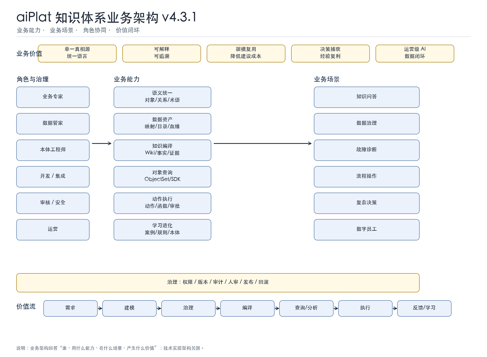
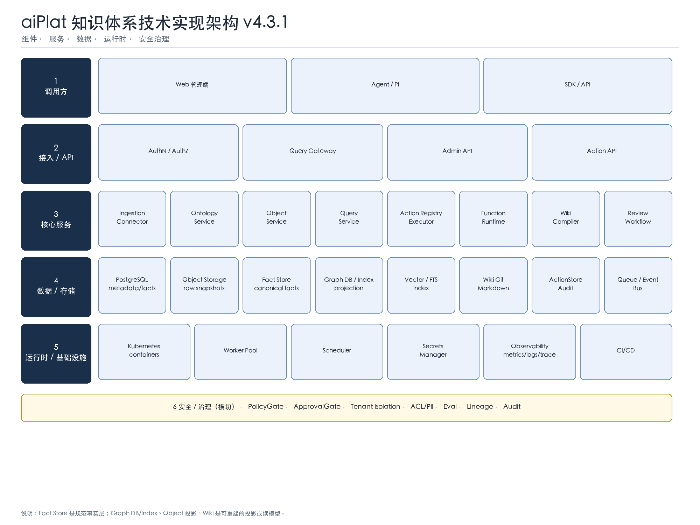
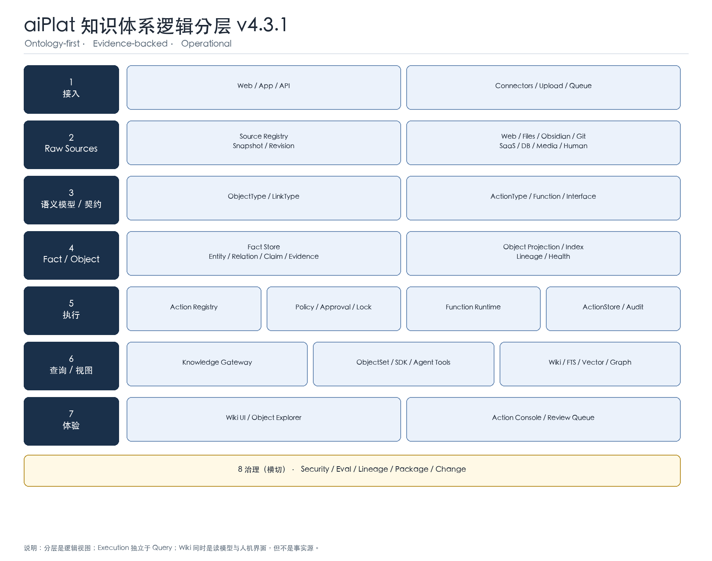

# aiPlat 知识体系技术白皮书 v4.3.1（已批准）

> **版本**：v4.3.1 · 2026-11-11
> **状态**：Approved Standard（2027-01-01 生效）
> **规范效力**：自 2027-01-01 起为强制标准
> **性质**：技术标准 / 目标架构
> **构成**：正文 + 规范性附录 + `schemas/`（标准包，三者同版本；Schema 入口 `schemas/knowledge-system.v4.3.1.schema.json`）
> **说明**：本标准定义目标规范与强制要求，不描述任何具体实现状态；实现符合性按第 16 章认证。
> **诚实边界**：不宣称“通用、无范围、无证据”的 RAG 准确率；允许范围限定、可复现的 benchmark 结论。不把 Wiki 当事实源，不以标准代替实现与验证。

---

## 标准声明

### 效力

- **批准日期**：2026-11-11；
- **生效日期**：2027-01-01；
- **生效后**：强制标准；
- **实现符合性**：必须按第 16 章单独认证，不能以“读过标准”代替。

### 批准

本标准已于 2026-11-11 由以下角色批准：

- Architecture Review；
- Security；
- Data Governance；
- Product。

作者可以担任 Architecture Review 或 Product，但必须同时满足：

- 在批准记录中披露作者身份；
- 记录利益冲突/职责分离豁免；
- Security 与 Data Governance 必须由非作者担任；
- 至少有一名非作者批准人；
- 作者不得单独批准。

批准记录写入 ADR 或 ADR 附件，包含版本、范围、例外、豁免和生效日期。

### 变更

- Major：不兼容的架构/契约变更；
- Minor：向后兼容的新增；
- Patch：编辑性修正。

任何变更不得静默修改；必须版本化、评审、记录。

### 构成

本标准包由**正文 + 规范性附录 + `schemas/`** 组成，三者同版本。附录中的字段名、必填规则、错误码、版本兼容和符合性清单与正文具有同等效力；示例值仅作说明。未附 schema 的标准包不完整，不得宣称符合。

### 冲突

- 本标准与实现文档冲突：以本标准为准；
- 本标准与代码冲突：代码是当前事实，但必须开 ADR 修正本标准或实现；
- 无法满足本标准：走 ADR 例外，记录范围、期限和补偿措施。

---

## 文档地图

| 正文 | 内容 | 对应附录 |
|---|---|---|
| 0–2 | 一页概览、七类痛点、三条闭环 | — |
| 3 | 业务架构、技术实现架构、逻辑分层 | — |
| 4 | 真相模型、可重建、Raw 变化 | A/B/D |
| 5 | 写入、读取、执行 | A/C/D |
| 6 | 语义模型与行为契约 | B/C |
| 7 | 事实/对象、对象索引、血缘、场景、来源策略 | D/K/L |
| 8 | 执行层、Action/Function Runtime | C/G |
| 9 | 查询、ObjectSet、SDK、Agent 工具 | E/F/M |
| 10 | Wiki、对象浏览器、动作台、审核台 | F |
| 11 | 更新传播、一致性、失败恢复 | A/D/H |
| 12 | 安全与多租户 | H |
| 13 | 质量、评测、准确率声明、校准报告 | I/O |
| 14 | 路线图 | — |
| 15 | 迁移与采用 | — |
| 16 | 符合性认证与清单 | N |
| 17 | 实施参考（非规范性） | — |
| 18 | 结论 | — |

> 阅读顺序：决策者读 0–3、13–16、18；架构师读全篇；工程师读 4–12 + 附录。

## 0. 先看一页：这套系统到底在做什么

很多知识系统的问题是：

> **资料收进来了，但用不起来；答得出来，但不一定准确；说得头头是道，但落不了地；做完了，但沉淀不下来。**

这里有两个不同的失败模式：

- **“答得出来，但不准确”**：事实/口径/证据有问题，属于“知识可信”问题；
- **“答得出来，但做不了”**：知道该怎么做，但不能安全地在业务系统里执行，属于“知识到行动”问题。

两者不是一回事，都要解决。

aiPlat 想做的是一条完整链路：

> **把资料收进来 → 变成业务对象和事实 → 能查、能推理 → 能安全地执行动作 → 把结果和案例再沉淀回本体。**

简要说明：

> **Raw 是“原件”，Ontology 是“业务地图”，Fact/Object 是“事实和对象”，Execution 是“真正去做”，Query 是“怎么查/怎么调”，Experience 是“人怎么用”，Governance 是“怎么保证不出事”。**

---

## 1. 七类痛点

### 1.1 语义不统一

同一客户、订单、产品，不同部门叫法不同；业务术语、数据字段、系统模型各说各话；业务与 IT 两张皮。

**结果**：数据对不上、口径吵不清、AI 答得看似合理但不可用。

### 1.2 数据与知识割裂

数据在库/表/API；知识在文档、提示词、FAQ、代码里；没有统一的对象层、数据映射和资产目录。

**结果**：每个新需求都重新做数据整合，知识无法复用。

### 1.3 知识与行动断裂

系统知道“该做什么”，但不能安全地做：缺动作、函数、SOP、审批、权限、审计。

**结果**：AI 只能问答，不能嵌入业务流程。

### 1.4 推理与洞察不足

只有关键词/向量检索，缺显式关系、隐性关系发现、一致性校验、模拟和决策。

**结果**：只能“找到相似内容”，不能“发现关系、判断影响、辅助决策”。

### 1.5 经验不沉淀、不自进化

案例、决策、反馈不回收；没有 `case → action → outcome → rule → ontology` 闭环。

**结果**：每次从零开始，组织经验无法复利。

### 1.6 答案不可信、治理不足

这条同时包含“答得准不准”和“敢不敢用”：

- 事实/口径不准，回答看似合理但不可验证；
- 无来源、无证据链；
- 无权限、无版本、无 owner、无审计；
- 无法解释、无法追责、无法规模化复用。

**结果**：Demo 很漂亮，生产不敢用；或者答得很快，但答错了。

### 1.7 建设成本高、难复用

每个需求重新集成；缺建模方法、工具、API、包和复用机制。

**结果**：没有规模经济，越做越重。

### 开头四句话，对应七类痛点

| 开头的失败模式 | 对应痛点 |
|---|---|
| 资料收进来了，但用不起来 | 1 语义不统一、2 数据/知识割裂、7 成本高 |
| 答得出来，但不一定准确 | 6 答案不可信 |
| 说得头头是道，但落不了地 | 3 知识/行动断裂、4 推理/洞察不足 |
| 做完了，但沉淀不下来 | 5 经验不沉淀 |


---

## 2. 三条闭环

八层架构解决“系统怎么分层”；三条闭环解决“系统怎么越用越聪明”。

### 2.1 语义治理闭环

> 数据/术语 → 本体 → 校验 → 数据资产目录 → 再治理

- 统一业务语言；
- 统一对象/属性/关系；
- 数据映射、血缘、质量；
- 本体不是 IT 私产，是业务与 IT 的契约。

### 2.2 推理决策闭环

> 本体 → 推理/校验 → 决策/模拟 → 动作 → 结果

- 显式关系、隐性关系；
- 一致性检查；
- what-if / dry-run；
- 决策理由可追溯。

### 2.3 学习进化闭环

> 动作 → 结果 → 案例 → 规则 → 本体

- 成功/失败案例都入库；
- 案例检索与推荐；
- 人审后更新规则/本体；
- 不自动改本体，避免自证。

---

## 3. 八层架构

| 层 | 一句话 | 里面有什么 |
|---|---|---|
| **1 接入** | 把资料接进来 | API、连接器、上传、队列 |
| **2 原始** | 原样保存，不改原文 | 网页、文件、Obsidian、Git、SaaS、数据库、图片/音视频、人工材料 |
| **3 语义模型/契约** | 给业务世界画地图，并定义能做什么 | 对象、关系、动作、函数、接口 |
| **4 事实/对象** | 把资料变成可查的事实和对象 | 实体、关系、断言、证据；对象视图、对象索引、血缘 |
| **5 执行** | 真正去做，而且做得安全 | 动作注册、函数运行、权限、审批、锁、审计、回滚 |
| **6 查询/视图** | 统一查、统一调 | Wiki、自然语言查询、对象集合、SDK、Agent 工具、FTS/向量/图索引 |
| **7 体验** | 人怎么用 | Wiki 浏览器/编辑器、对象浏览器、动作台、审核台、场景对比 |
| **8 治理** | 怎么保证不出事 | 安全、血缘、评测、版本、包、变更管理 |

### 3.1 业务架构图



**这张图回答：谁、用什么能力、在什么场景、产生什么价值。**

| 维度 | 内容 |
|---|---|
| **角色** | 业务专家、数据管家、本体工程师、开发/集成、审核/安全、运营 |
| **业务能力** | 语义统一、数据资产、知识编译、对象查询、动作执行、学习进化 |
| **业务场景** | 知识问答、数据治理、故障诊断、流程操作、复杂决策、数字员工 |
| **业务价值** | 单一真相源、可解释、规模复用、决策捕获、运营级 AI |
| **价值流** | 需求 → 建模 → 治理 → 编译 → 查询/分析 → 执行 → 反馈/学习 |

### 3.2 技术实现架构图



**这张图回答：有哪些服务、哪些存储、哪些运行时组件、怎么调用与写回。**

| 层 | 组件 |
|---|---|
| **调用方** | Web 管理端、Agent/Pi、SDK/API |
| **接入/API** | AuthN/AuthZ、Query Gateway、Admin API、Action API |
| **核心服务** | Ingestion/Connector、Ontology Service、Object Service、Query Service、Action Registry/Executor、Function Runtime、Wiki Compiler、Review Workflow |
| **数据/存储** | PostgreSQL、对象存储、Graph DB/Index、Vector/FTS、Wiki Git/Markdown、ActionStore/Audit、Queue/Event Bus |
| **运行时/基础设施** | Kubernetes、Worker Pool、Scheduler、Secrets Manager、Observability、CI/CD |
| **安全/治理** | PolicyGate、ApprovalGate、Tenant Isolation、ACL/PII、Eval、Lineage、Audit |

**主路径：**

- 写：调用方 → Admin API → Ingestion/Ontology → PostgreSQL/Object Storage → Wiki/Index；
- 读：调用方 → Query Gateway → Object/Query/Wiki/Index → 回答；
- 执行：Action API → Action Registry/Executor → Policy/Approval → Handler/Function → ActionStore/Audit → 写回 Fact Store；
- 治理：安全/审计/评测/血缘横切所有服务。

### 3.3 逻辑分层图



**这张图回答：系统按什么逻辑分层。**

- 实线：数据/调用；
- 虚线：执行写回/反馈；
- 底部：治理横切；
- Wiki 同时是 Query/Views 的读模型和 Experience 的人机界面，但不是事实源。

**一句话路径：**

> 接入 → Raw → Ontology → Fact/Object → Execution → Query/Views → Experience；Governance 横切；Action 执行后写回 Fact Store。

### 3.4 一句话记住

> **接入 → 原件 → 语义模型 → 事实 → 执行 → 查询 → 界面 → 治理。**

---

## 4. 真相模型：什么能改，什么不能改

| 东西 | 是不是事实源 | 说明 |
|---|---|---|
| Raw sources | 是 | 原件，不能改 |
| Ontology | 是（schema） | 语义模型，定义规则 |
| Fact Store | 是 | 事实账本，带证据 |
| ActionExecution | 是 | 做过什么，也是事实 |
| ObjectType | 是（schema） | 类型、属性、链接、数据绑定 |
| ObjectInstance | 否（投影） | 事实账本中的对象实例视图 |
| Object Index | 否（派生） | 为了查得快，可重建 |
| ObjectSet | 否（查询结果） | 一次查询结果 |
| Wiki | 否（读模型） | 给人读的页面 |
| SDK | 否（facade） | 自动生成的调用工具 |
| App | 否（体验层） | 界面，不拥有事实 |

**三条铁律：**

1. 不复制第二套对象事实；
2. **Wiki/索引/对象视图/对象集/SDK 是可重建的派生视图；但 Raw、Ontology、Fact Store、ActionExecution 不是“可重建的视图”**；
3. 模拟/场景不污染主事实。

### 4.1 “可重建”是有条件的

“可重建”不是无条件保证。只有以下输入都留存，才可能重建：

- Raw snapshot；
- Ontology 版本；
- 抽取器/模型/规则版本；
- 人工审核/编辑记录；
- 权限/策略版本；
- 生成器/编译器版本；
- 外部数据源 schema 快照。

| 重建级别 | 条件 | 结果 |
|---|---|---|
| **精确重放** | 输入、版本、人工改动、外部依赖全部留存 | 可得到一致结果 |
| **语义重建** | 缺人工改动，但有规则/模型版本 | 可得到近似结果，需人审 |
| **不可重建** | 缺原始输入、版本或人工决策 | 只能保留现状，不能假装重建 |

**MUST：**

- 人工编辑必须记录 patch/decision，而不是只存最终页面；
- 模型/规则/生成器版本必须随产物记录；
- 外部数据绑定必须保存 schema/时点；
- 无法精确重放时，必须标“近似重建”，不能标“可重建”。

**因此**：Raw 变化时，不是只重建 Wiki/索引，而是必须更新 Fact Store、对象视图/索引、Wiki、SDK；Raw 更新不直接产生 ActionExecution，只有新动作执行才追加记录；Ontology 走“漂移检测 + 提案 + 版本”。

### 4.2 Raw 变化时，谁更新？

| 对象 | 是否更新 | 方式 |
|---|---|---|
| Raw sources | 新 Revision | 旧快照保留，不原地改 |
| Ontology | **不自动改** | 漂移检测 → 提案 → 人审 → 新版本 |
| Fact Store | **必须更新** | 增量重抽取；旧事实 superseded/retired |
| ActionExecution | **不因 Raw 更新而改** | 只有新动作执行才追加；旧记录保留 |
| Object 视图 | 更新/重建 | 从 Fact Store 投影 |
| Object Index | 重建 | 搜索/过滤/聚合 |
| Wiki | 重编译 | 受影响页面 |
| ObjectSet | 重新查询 | 查询结果不存储；保存视图只存查询定义 |
| SDK | 契约变化才再生成 | 否则只失效缓存 |

---

## 5. 写入、读取、执行

### 5.1 写入

1. 登记资料；
2. 保存不可变快照；
3. 解析/分块；
4. 映射到对象类型；
5. 抽取事实；
6. 校验/实体解析；
7. 人审；
8. 写事实账本；
9. 生成对象视图/索引；
10. 编译 Wiki；
11. 建检索索引；
12. 发布 SDK/包（可选）。

### 5.2 读取

1. 校验租户/权限；
2. 理解问题；
3. 先查对象/事实；
4. 对象集合查询/聚合；
5. 函数计算；
6. Wiki 解释；
7. 关键词/向量/图兜底；
8. 融合/冲突裁决；
9. 引用；
10. 回答或“不知道”；
11. 要执行 → 返回动作候选，不直接做。

### 5.3 执行

1. 校验动作契约；
2. 权限/策略；
3. 审批（需要时）；
4. 实体锁；
5. 执行函数/处理器；
6. 写执行记录/审计；
7. 更新事实/对象状态；
8. 发事件；
9. 投影到对象索引/Wiki。

---

## 6. 语义模型与行为契约

本标准不使用“本体包含一切”的宽泛说法。准确关系是：

| 层 | 内容 | 说明 |
|---|---|---|
| **TBox** | 类型、属性、关系、公理、约束 | 语义 schema |
| **ABox** | 实例、关系实例、claim | 语义事实 |
| **行为契约** | ActionType、Function、Interface | 绑定到语义模型的可执行/可调用契约，不是 TBox 本身 |

`Ontology-first` 的含义是：先有语义模型，再有行为契约；不是把 Action/Function/API 都叫成“本体”。

### 6.1 对象与关系

ObjectType 是**语义 schema + 数据绑定**；ObjectInstance 才是 Fact Store 的对象投影。

- 有哪些对象；
- 主键是什么；
- 有哪些属性；
- 和谁有关系；
- 数据从哪来；
- 怎么索引/同步；
- 谁能看。

`ObjectType` 不是“第二套事实”，也不是“纯派生视图”；它定义类型、属性、链接和数据绑定。`ObjectInstance` 才是从 Fact Store 投影出来的实例视图。

### 6.2 动作

动作是“业务上能做的事”，不是任意 API/SQL：

- 对哪个对象做；
- 前置状态；
- 输入/输出；
- 权限/审批；
- 做了什么效果；
- 失败怎么回滚；
- 谁做的、什么时候做的。

**动作执行记录本身也是事实。**

### 6.3 函数

函数是“计算/校验”，默认不产生副作用：

- 算优先级；
- 校验规则；
- 动作前后处理；
- 跨对象计算。

有副作用 → 必须走动作。

### 6.4 接口

接口是“多个对象类型的共同契约”：

- 都有某个属性；
- 都能做某个动作；
- 可以统一查询/批量操作。

### 6.5 自动生成，还是人工添加？

结论：**声明可以自动起草，实现必须可审查，发布必须过门。**

| 产物 | 谁定义语义 | 谁实现 | 能否自动生成 |
|---|---|---|---|
| **对象/关系** | 业务专家 + 本体工程师 | 数据工程/平台 | 可从 DB/文档生成候选，人审后发布 |
| **动作** | 业务专家 + 本体工程师 | 开发/集成工程师写 handler | 可生成契约草稿；handler 必须实现/测试/审批 |
| **函数** | 业务/开发 | 简单函数可配置；复杂函数写代码 | 可生成草稿；确定性/测试/权限通过才可发布 |
| **接口** | 架构师/本体工程师 | 平台/开发 | 可根据对象相似性建议；必须人审，不自动发布 |

#### 自动生成的三个边界

1. **候选生成**：可以从文档、数据库、API、现有对象中提议“可能有哪些动作/函数/接口”；
2. **契约草稿**：可以生成 ActionContract / FunctionContract / Interface 的 YAML 草稿；
3. **实现与发布**：
   - 有副作用的动作，handler 必须可审查、可测试、可回滚；
   - 函数必须声明确定性/副作用/权限/超时；
   - 接口必须通过兼容性校验；
   - **不允许“LLM 生成后自动发布”**。

#### 一句话

> **AI 可以帮你“起草本体”，但不能替你“批准本体”；程序员不是唯一作者，业务/本体工程师定义语义，开发实现 handler，安全/平台负责门禁。**

### 6.6 通过管理画面添加与发布

目标：**业务/本体工程师在管理画面完成 80% 的配置；开发只处理复杂 handler；平台负责门禁。**

#### 6.6.1 管理画面模块

| 页面 | 作用 |
|---|---|
| **本体管理** | 对象类型、关系类型、接口、属性、数据映射 |
| **动作设计器** | 动作契约、目标对象、输入/输出、前置条件/效果、权限/审批、handler、回滚、自主度 |
| **函数设计器** | 函数契约、实现方式（表达式/规则/SQL/API/handler）、测试 |
| **接口设计器** | 共享属性/关系/动作、实现者、兼容性校验 |
| **测试与发布** | dry-run、影响预览、权限测试、审核、版本发布 |
| **动作控制台** | 执行、审批、回滚、查看结果 |
| **审核台** | 低置信、冲突、高风险动作、待发布 |
| **审计/版本** | diff、历史、回滚 |

#### 6.6.2 Action Designer 的操作顺序

1. 选择域/对象；
2. 填写动作名称/说明；
3. 配置输入/输出字段；
4. 配置前置状态/禁止状态/效果；
5. 配置权限/角色/审批；
6. 选择执行方式：
   - 内置动作；
   - 已注册 handler；
   - API 连接器；
   - 只读 SQL 模板；
   - 自定义 handler（需开发提供）；
7. 配置回滚/幂等/超时；
8. 选择自主度 Lv1–Lv4；
9. 用样例对象做 dry-run；
10. 提交审核/发布。

#### 6.6.3 哪些能在画面配，哪些必须写代码

| 类型 | 例子 | 方式 |
|---|---|---|
| **No-code** | 简单 CRUD、字段校验、接口定义、权限/审批 | 画面配置 |
| **Low-code** | 选已有 handler、API 连接器、只读 SQL 模板、表达式函数 | 画面 + 少量参数 |
| **Pro-code** | 复杂事务、跨系统补偿、特殊算法 | 开发写 handler，注册后画面选择 |

> 管理画面不直接写图/数据库；它调用 Admin API，由后端校验、注册、发布。

#### 6.6.4 发布门

- 契约/schema 合法；
- 权限/审批配置完整；
- dry-run 通过；
- 执行/回滚测试通过；
- 安全/业务审核；
- 不能自审自批；
- 版本化，可回滚。

#### 6.6.5 自动生成在画面里的位置

- “AI 起草”按钮：生成动作/函数/接口草稿；
- 生成后进入 draft，不直接 published；
- 复杂 handler 仍由开发实现；
- 审核通过后才对 Action Console/SDK/Agent 可见。

#### 6.6.6 管理画面的验收

- 能完成动作/函数/接口的 draft → review → publish；
- 能配置权限/审批/回滚/自主度；
- 能 dry-run 并查看影响；
- 发布后能被 Action Console/SDK/Agent 发现；
- 所有操作有审计和版本。

### 6.7 SQL 边界

- 生成 SQL 不是动作；
- 只读查询可作为低风险工具；
- 增删改必须是动作 + 审批 + 回滚；
- 建表/改表必须是高风险变更；
- 不允许“随便传一段 SQL 就执行”。

---

### 6.8 推理、建议与事实的边界

- 推断产生的事实必须标记 `inferred=true`；
- 推理/建议不得直接写 Fact Store，不得直接改对象状态；
- 落库必须经显式 Action 或本体提案，并保留来源、模型版本和审批；
- UI/API 必须把“建议”与“已确认事实”分开；
- 禁止把推断边、相似度匹配或 LLM 断言当作 confirmed。

## 7. 事实/对象层

### 7.1 事实账本

存：

- 实体；
- 关系；
- 断言；
- 证据；
- 审核；
- 修订；
- 冲突；
- 动作执行记录。

每个事实必须有来源；没有来源就不算事实。

### 7.2 对象视图

> 事实账本 → 对象类型投影 → 对象实例 → 对象索引

- 对象类型是“地图”；
- 对象实例是“地图上的点”；
- 对象索引是“为了查得快”；
- 都不是第二套事实。

### 7.3 血缘与健康

- 数据 → 对象；
- 对象 → 动作；
- 动作 → 证据；
- 同步延迟/失败/缺失/重复/链接断裂；
- 对象不同步时，动作应阻断或降级。

### 7.4 场景/分支

- 先模拟，不写主事实；
- 分支有 owner/过期；
- 合并必须人审；
- 不把模拟当事实。

### 7.5 Fact Store 数据契约

Fact Store 是**逻辑上的规范事实层**，不绑定某个数据库产品。可以用关系表、三元组、图数据库或文档库实现；GraphIndex 是它的图投影，不是第二套事实。

#### 7.5.1 记录类型

| 记录 | 内容 |
|---|---|
| **Fact** | 实体、属性、关系、状态；有证据、有效时间、审核状态 |
| **Claim** | 一条可引用断言；可被采纳/争议/撤回 |
| **Evidence** | source_id、locator、quote、hash、抓取时间 |
| **Review** | reviewer、decision、reason、time |
| **Revision** | before/after、actor、time、reason |
| **Conflict** | 多值、来源、时间、裁决状态 |
| **ActionExecution** | 动作执行记录；追加不改历史 |

#### 7.5.2 强制字段

每个 Fact/Claim 必须带：

- `tenant_id` / `collection_id`；
- `evidence[]`（至少一条）；
- `source_policy`（来源权威/时效/适用范围）；
- `extractor_version` / `model_version`（如适用）；
- `review_status`；
- `status`（生命周期）；
- `confidence`（Fact/Claim 用 0–1 数值；查询响应用 high/medium/low；定义见 9.6.5/9.6.7）；
- `valid_from` / `valid_to`；
- `revision`。

**MUST NOT：**

- 无 evidence 的 fact/claim 进入 published；
- 用 `confidence=high` 代替证据；
- 覆盖旧事实而不记录 revision；
- 把推断关系直接写成事实，除非标记 `inferred=true` 且经审核。

#### 7.5.3 写入权威

只有以下路径可以写 Fact Store：

1. 摄入/抽取管线；
2. 人审/裁决；
3. Action Execution 的结果；
4. 经批准的迁移/回填。

查询层、Wiki、索引、SDK、Agent 工具不得直接写 Fact Store。

#### 7.5.4 Fact 与 Claim、属性、推断的区别

| 类型 | 说明 | 是否可直接发布 |
|---|---|---|
| 属性 | 实体上的字段值 | 需 evidence + review |
| 关系 | 两个实体之间的边 | 需 evidence + review |
| Claim | 可引用断言，可能带时间/条件 | 需 evidence + review |
| 推断关系 | 由规则/推理产生 | 默认 `inferred=true`，需审核 |
| ActionExecution | 执行历史 | 追加，不可改写 |

#### 7.5.5 Fact/Claim 状态机

Fact/Claim 必须区分**审核状态**与**生命周期状态**，不能用一个 `status` 混用。

**审核状态 `review_status`：**

| 状态 | 含义 | 允许转换 |
|---|---|---|
| draft | 候选，未审核 | reviewed / rejected |
| reviewed | 人审通过，未发布 | published / rejected |
| published | 已发布，可被引用 | reviewed（重审）/ rejected |
| rejected | 拒绝 | draft（重提） |

**生命周期状态 `status`：**

| 状态 | 含义 | 允许转换 |
|---|---|---|
| active | 当前有效 | superseded / retracted / archived |
| superseded | 被新版本取代 | archived |
| retracted | 撤回/失效 | archived |
| archived | 历史留存 | — |

规则：

- `review_status` 只能由 reviewer 改为 `published`；
- `status` 由系统/ reviewer 按事实有效性变更；
- 自动规则不能绕过 reviewer；
- `retracted` 不物理删除；
- 每次转换记录 actor/time/reason/revision；
- 冲突未裁决不得 `review_status=published`；
- Claim 的 `status` 使用 `accepted / contested / retracted / archived`，与 Fact 的 active 语义对应。

### 7.6 来源策略与冲突裁决

**Raw 是证据，不是自动真理。** 原始来源可能过期、矛盾、权限不同、可信等级不同。

#### 7.6.1 来源策略

每个来源/域必须配置：

- `authority`：权威级别；
- `freshness`：有效期/时效；
- `scope`：适用对象/字段/场景；
- `license`：许可/使用限制；
- `trust`：可信等级；
- `conflict_rule`：冲突处理规则。

#### 7.6.2 冲突裁决

```text
证据原件（Raw）
  → 来源策略（权威/时效/范围）
  → 业务 claim（采纳/争议/撤回 + 裁决理由）
```

- 不允许固定 `Raw > KG > Wiki`；
- 冲突必须显式记录，不自动选边；
- 裁决可由规则 + 人审完成；
- 裁决理由必须可审计；
- Wiki 是派生视图；**经过人审的 Wiki 页可作为带来源的二级证据**，但不是权威事实源。

---

### 7.7 运行时权威与审计快照

| 对象 | 权威角色 |
|---|---|
| Raw sources | 证据，不改写 |
| Fact Store | 规范事实层，Action/审计的业务状态以此为准 |
| GraphIndex / ObjectIndex | Fact Store 的图/对象投影，可重建 |
| Wiki | 读模型，不进入审计权威链 |
| ActionExecution | 执行历史，追加不改写 |

规则：

- `before_snapshot` / `after_snapshot` 必须来自 Fact Store 的 revision/snapshot，不得用 Wiki 页面顶替；
- 实体不存在时 Action 必须失败或返回 `entity_missing`，不得用 Wiki 内容兜底；
- GraphIndex/Wiki 与 Fact Store 不一致时，先记录投影差异并重建，不得反向覆盖事实；
- 当前实现若用 GraphIndex 承载 Fact Store 的图投影，必须在实现文档中明确这一映射。

## 8. 执行层

### 8.1 执行边界

- 不允许任意处理器；
- 不允许绕过权限/审批；
- 不允许无审计；
- 不允许无幂等/回滚；
- 不允许查询层直接执行；
- 不允许 Agent 直接改图/跑 SQL。

### 8.2 自主度

| 级别 | 说明 |
|---|---|
| Lv1 | 只读/建议，不改东西 |
| Lv2 | 人确认后才做 |
| Lv3 | 满足规则可自动做 |
| Lv4 | 自动闭环，但要有误报率门和审计 |

### 8.3 与 Wiki/对象/SDK 的关系

- 动作记录写事实账本；
- 对象状态通过动作改变；
- Wiki 解释动作，但不执行；
- 对象浏览器展示动作，但执行走动作注册；
- SDK 只生成调用，不绕过执行门。

---

### 8.4 约束分层

| 层 | 机制 | 作用 | 失败后果 |
|---|---|---|---|
| L1 硬门 | ActionContract / PolicyGate / ACL / 状态机 | 否决非法动作 | 阻塞执行 |
| L2 软约束 | 公理、规则、prompt、校验提示 | 降低错误，可被模型忽略 | 不得单独作为安全边界 |
| L3 审计 | ActionExecution、快照、审批、对账 | 事后追责与恢复 | 不替代 L1 |

规则：

- `L1 > L2 > L3`；
- 没有 L1 的高风险动作不得进入生产；
- 只有 prompt/规则提示、没有执行层硬门的“安全”不合格；
- L2 必须编译当前域/集合的约束，不得只读全局提示。

### 8.5 动作审计与闭环门

客户运营动作的 ActionExecution 必须包含：

- `before_snapshot` / `after_snapshot`；
- `approval_id`（需要审批时）；
- `run_id` / `evidence_ref`（能关联到流程与证据）；
- `idempotency_key`、`audit_hash`、`result/error`。

规则：

- 自动闭环（Lv4）必须有历史误报率证据、回滚/补偿、kill switch 和人工退出机制；
- 没有误报率证据时，最高只允许 Lv1–Lv3；
- 客户动作与平台动作必须有可区分的 `namespace` / `action_namespace` 和审计保留策略；
- 动作执行不得绕过 PolicyGate/ApprovalGate。

## 9. 查询层

### 9.1 查询内核

统一入口负责：

- 租户/权限；
- 理解问题；
- 路由；
- 多源融合；
- 冲突裁决；
- 引用；
- 降级说明。

**禁止：** 每个入口各写一套检索；查询层直接执行动作。

### 9.2 对象集合

- 过滤；
- 排序；
- 聚合；
- 关系展开；
- 保存视图（只存查询定义，不存事实）；
- 导出（受权限）。

### 9.3 SDK

由本体自动生成：

- 对象类型 → 类型化模型；
- 关系 → 遍历接口；
- 动作 → 类型化调用；
- 函数 → 类型化调用；
- 对象集合 → 查询构造器。

不允许手写一套平行 API。

### 9.4 Agent 工具

| 工具 | 用途 |
|---|---|
| object.query | 查对象 |
| link.traverse | 多跳关系 |
| function.call | 计算/校验 |
| action.execute | 执行动作 |
| object_set.aggregate | 聚合 |

规则：有 schema、有权限、有审计；不允许通用 SQL 工具。

### 9.5 索引

- 关键词；
- 向量；
- 图；
- 对象索引。

索引都可重建，不是事实源。

### 9.6 查询契约

Gateway 的行为必须是可定义、可审计的，不能只靠“模型自己决定”。

#### 9.6.1 请求

必须包含：

- `tenant_id` / `collection_id`；
- `query`；
- `query_type`（fact/object/wiki/relation/aggregate/action_candidate）；
- `mode`（auto/structured/wiki/fts/vector/hybrid/graph）；
- `filters` / `time_range`；
- `top_k` / `budget_ms`；
- `require_citations`。

#### 9.6.2 路由与权限

- 路由必须产生 `route_plan` 和 `route_reason`；
- 权限过滤必须在**召回前**执行；
- 聚合、导出、缓存使用同一权限；
- 不允许“先查全量再前端过滤”。

#### 9.6.3 超时、预算与降级

- 每个检索器有独立超时/预算；
- 单路失败不能拖垮整个查询；
- 降级必须返回 `degraded=true` 和 `degraded_reason`；
- 部分结果必须标 `partial=true`，并提供 `degraded_reason`。

#### 9.6.4 引用

- 引用必须能定位到 source snapshot + locator 或 claim；
- 无 citation 的关键断言不得返回；
- 无证据时必须 `abstained=true`。

#### 9.6.5 置信度

`confidence` 不是魔法字符串，至少由以下维度组成：

| 维度 | 含义 |
|---|---|
| evidence_coverage | 关键断言是否有证据 |
| source_authority | 来源权威级别 |
| conflict | 是否存在未裁决冲突 |
| coverage | 检索/对象覆盖是否充分 |
| freshness | 是否在有效期内 |

任何单一维度不足，都不能标 `high`。

#### 9.6.6 审计

必须记录：

- query plan / route；
- 实际使用的 source/index；
- 权限过滤；
- 超时/降级；
- citations；
- 最终 confidence / abstained / conflicts。

#### 9.6.7 置信度校准

`confidence` 必须有可复现的校准规程，不能只靠模型自评。

**最低验收程序：**

| 项 | 要求 |
|---|---|
| 校准集 | 每个域、每个 query_type 至少 100 条 gold；不足需统计论证 |
| 标注 | 至少 20% 双人标注；记录一致率 |
| 权重 | 由 domain owner + method owner 批准；冻结到下次校准 |
| 验证 | 报告 ECE、Brier、high 精度、覆盖率、样本量、CI |
| 门槛 | 默认 ECE ≤ 0.05、high 精度 ≥ 0.90；域可更严，不可更松 |
| 失败降级 | 样本不足/ECE 超标/分布漂移 → confidence 最高只能 `medium` |
| 版本 | 记录 `calibration_version`、数据集版本、模型/索引版本 |
| 可比性 | 不同域的 `high` 不得直接比较，除非校准集和门槛一致 |

**规则：**

- `high` 必须满足：evidence_coverage=1、无未裁决冲突、freshness 有效、coverage ≥ 域门槛；
- 模型/索引/来源策略变化后必须重新校准；
- 校准报告必须可审计、可复现；
- 校准失败不得静默放宽门槛。

---

### 9.7 防假绿与降级

- 检查结果使用 `verification` 对象：`status`、`valid`、`checks_run`、`skipped_checks`、`reason`；
- `valid=true` 只能在检查实际执行且无跳过时返回；
- 未执行检查 → `verification.status=unchecked`，`valid` 必须为 false；
- 部分检查失败/跳过 → `verification.status=error/degraded`，并列出 `skipped_checks[]`；
- Query 返回 `partial` / `degraded` 时必须给出 `degraded_reason`；
- 无 citation 的关键断言不得返回，必须 `abstained=true`。

## 10. 体验层

### 10.1 Wiki 的双重角色

Wiki 不只是“体验层”，它有两个角色：

| 角色 | 位置 | 作用 |
|---|---|---|
| **读模型/检索源** | 查询/视图层 | Markdown + FTS/向量，服务 Gateway/Agent，提供可读上下文和引用 |
| **体验界面** | 体验层 | 浏览器、编辑器、审核、链接导航 |

所以：

- 作为“知识工件”，Wiki 在查询/视图层；
- 作为“人机界面”，Wiki 在体验层；
- 但它始终不是事实源。

Wiki 的职责：

- 给人读；
- 给人审；
- 给人引用；
- 记录矛盾；
- 沉淀好答案。

Wiki 不是事实源，也不是唯一入口。

### 10.2 对象浏览器

- 看对象；
- 看属性/关系；
- 看对象集合；
- 看历史/血缘；
- 受权限限制。

### 10.3 动作台

- 动作表单；
- 影响预览；
- 先模拟；
- 审批；
- 结果/回滚。

### 10.4 审核台

- 低置信事实；
- 冲突；
- 新类/新关系；
- 高风险动作；
- 过期内容。

### 10.5 场景对比/运维看板

- 多方案对比；
- 同步健康；
- 失败/延迟；
- 索引滞后；
- 动作成功率。

---

## 11. 更新传播

### 11.1 更新流程

资料更新不是改原件，而是：

1. 新快照；
2. 影响分析；
3. 重抽取；
4. 校验/冲突/人审；
5. 更新 Fact Store；
6. 更新对象视图/索引；
7. 重编译 Wiki；
8. 重建检索索引；
9. SDK 契约变化则再生成，否则失效缓存；
10. ActionExecution 不因 Raw 更新而改；只有新动作执行才追加；
11. Ontology 只做漂移检测/提案，不自动改；
12. 审计。

**关键：**

- Fact Store 必须更新，不是只更新 Wiki；
- ActionExecution 是历史事实；Raw 更新不产生新执行，只有新动作才追加；
- Ontology 是 schema，不能因为 Raw 变了就自动改；
- 删除用墓碑；旧事实标失效；冲突不自动选边；模拟不污染主事实。

### 11.2 一致性模型

#### 时间

- `valid_from/valid_to`：业务有效时间；
- `recorded_at`：进入系统的时间；
- 支持“当时正确”的查询，不能只存当前值。

#### 修订

- 每次变更产生 revision；
- 旧 revision 保留；
- 不允许无记录覆盖；
- 支持 diff/回滚。

#### 删除

- 用 tombstone，不物理删历史；
- 下游视图标 stale/retired；
- 审计保留。

#### 事件与幂等

- 写入用 idempotency key；
- 事件至少一次投递，消费端幂等；
- 处理部分失败/重试/死信；
- 长事务用补偿，不依赖跨库 2PC。

#### 分支

- Scenario/Branch 隔离；
- 合并必须人审；
- 模拟不写主事实。

### 11.3 跨存储失败恢复

- Fact Store 提交后，投影/Wiki/索引失败：用 outbox/事件重试；
- 投影必须幂等，可按 revision 对账；
- ActionExecution 与外部系统无法原子提交：记录 `unknown`，通过查询/补偿对账；
- 不允许把“投影失败”当成“事实失败”；
- 不允许把“外部系统成功”当成“执行记录已写”；
- 对账任务必须可重跑、可审计。

---

## 12. 安全与多租户

### 12.1 隔离

- 租户/集合硬边界；
- 对象/索引都带 tenant；
- 跨租户 0 结果；
- 共享本体只共享 schema。

### 12.2 权限

| 层 | 控制 |
|---|---|
| 对象 | 行级/对象级 |
| 属性 | 字段级/掩码 |
| 关系 | 可见性 |
| 动作 | 执行权/审批 |
| 函数 | 调用权 |
| 接口 | 实现/查询权 |
| 视图 | 受限视图 |

前端过滤不算安全；聚合不能泄漏；导出同权限。

### 12.3 权限传递

权限必须在以下全部生效：

- Gateway；
- ObjectSet；
- SDK；
- Agent 工具；
- Wiki；
- 缓存；
- 导出；
- 检索索引。

规则：

- 召回前过滤；
- 聚合不泄漏；
- 跨对象 join 不绕过；
- 权限变更后缓存失效；
- 审计记录访问目的。

---

### 12.4 实例与字段级授权

- 权限必须覆盖对象、实例、字段和动作，不只覆盖页面/接口；
- 召回前过滤，聚合、导出、缓存、SDK 同权限；
- 字段级脱敏必须在返回前完成；
- 跨租户必须 0 结果，不得通过错误码暴露租户存在性；
- 不宣称“企业全域 CBAC”已产品化；只声明已实现的对象/字段级竖切。

## 13. 质量、评测与声明

### 13.1 指标

- 本体覆盖；
- 语义完整度（OCS）；
- 对象同步健康；
- 动作成功率/回滚率；
- 函数正确性；
- 检索召回；
- Wiki 引用覆盖；
- 回答正确率/事实一致性；
- 回答忠实度；
- 跨租户隔离；
- SDK 契约兼容。

### 13.2 准确率声明

- 不宣称通用准确率；
- 允许范围限定 benchmark；
- 必须绑定数据集/版本/配置/样本量/置信区间/日期；
- 不用检索召回代替回答正确率；
- 不用单次 demo 代替 benchmark。

### 13.3 指标定义与门槛

指标必须有定义、数据集、版本和门槛，不能只列名字。

| 指标 | 定义 | 默认基线（域可提高，不可降低） |
|---|---|---|
| 检索 Recall@10 | 相关证据在前 10 的比例 | ≥ 0.80 |
| 回答正确率 | 与 gold answer 一致的比例 | ≥ 0.80 |
| 引用准确率 | citation 指向正确 source/locator 的比例 | ≥ 0.95 |
| citation 命中率 | 关键断言至少有一个可定位 citation 的比例 | ≥ 0.99 |
| 忠实度 | 回答是否被引用证据支持 | ≥ 0.90 |
| abstain 正确率 | 无证据时正确拒答的比例 | ≥ 0.90 |
| 对象同步健康 | 成功同步对象/总对象 | ≥ 0.99 |
| 动作成功率 | 成功执行/总执行 | ≥ 0.99 |
| 跨租户泄漏 | 负向测试泄漏数 | = 0 |

`引用准确率` 衡量 citation 是否正确；`citation 命中率` 衡量关键断言是否有 citation。两者不可互换。

规则：

- 每个指标绑定数据集版本、配置、模型/索引版本；
- 默认基线是强制下限；域可以更严，不能更松；
- 降低默认基线必须走 ADR，并记录风险接受；
- 未配置门槛时采用默认基线；
- 评测不达标不得发布；
- 评测结果可复现。

---

### 13.4 语义完整度（OCS）

OCS 用于回答“这个域的业务世界是否建完整”，不是“答案是否真实”。

| 维度 | 权重 | 说明 |
|---|---:|---|
| 类与属性 | 15 | 类、必填字段覆盖 |
| 状态机 | 20 | 状态、转换、触发器 |
| 公理/证据 | 15 | 约束可加载、可追溯 |
| Action 硬门 | 25 | 状态约束、权限、回滚 |
| 事实层 | 15 | 实例/边覆盖 |
| 演化闭环 | 10 | 提案、审批、回滚记录 |

规则：

- OCS 按域计算 0–100，阈值由域 owner 配置；
- OCS ≥ 阈值只表示该域“纵深完整”，不表示企业全域完整；
- OCS 不得用节点数/页面数替代；
- OCS 不替代准确率、忠实度、权限和 Action 审计。

## 14. 路线图

### 14.1 Phase 0：事实底座

原件、资料登记、事实账本、统一查询、租户隔离、Wiki/索引可重建。

### 14.2 Phase 1：对象与函数

对象类型、对象视图/索引、函数、接口、血缘/健康。

### 14.3 Phase 2：动作与查询

动作契约/注册、权限/审批/锁/审计、对象集合、SDK、对象级安全。

### 14.4 Phase 3：体验与场景

Wiki 规模化、对象浏览器、动作台、审核台、场景/分支、Agent 工具。

### 14.5 Phase 4：规模化

生产级 PostgreSQL/对象存储/图/向量索引选型、多 worker、多模态、联邦知识、包/认证/审计。

### 14.6 运行与容量

#### 部署职责

- 无状态服务可水平扩展；
- 有状态存储明确主写/副本；
- Worker 与 API 分离；
- 定时任务与事件消费者分离；
- 对象存储/数据库/队列有独立备份策略。

#### SLO（默认目标；可更严；放宽需 ADR 并记录风险接受）

| 指标 | 默认目标 |
|---|---|
| ingest 成功率 | ≥ 99.9% |
| ingest p95 延迟 | ≤ 5 分钟 |
| object sync p95 延迟 | ≤ 5 分钟 |
| query p95 | ≤ 2 秒 |
| action 成功率 | ≥ 99.5% |
| citation 命中率 | ≥ 99% |
| 索引重建耗时 | ≤ 4 小时 |
| 跨租户隔离测试通过率 | 100% |

#### 容量

- 文档数/对象数/关系数；
- 每日新增/变更量；
- 向量维度/索引大小；
- 查询 QPS/并发；
- 动作执行峰值；
- 重建窗口/成本。

#### 恢复

- 备份/恢复演练；
- 重建/回放演练；
- 故障降级；
- 审计留存。

---

## 15. 迁移与采用

本标准不要求一次性替换现有系统；采用方必须定义迁移方案。

### 15.1 映射

- 现有 Wiki → 读模型/页面；
- GraphIndex → 事实/对象投影；
- 向量 KB → Raw/检索索引；
- TripleStore → 语义/关系；
- 业务库 → Source/ObjectType 绑定。

### 15.2 迁移步骤

1. 盘点现有资产与 owner；
2. 建立目标对象/事实/证据映射；
3. 双写或影子写；
4. 回填；
5. 对账；
6. 灰度读；
7. 切换写；
8. 回滚演练；
9. 旧系统退役。

### 15.3 验收

- 数据不丢；
- 证据可追溯；
- 权限不扩大；
- 查询结果可对账；
- 动作可回滚；
- 旧系统只读/退役有记录。

---

## 16. 符合性认证

### 16.1 等级

| 等级 | 要求 |
|---|---|
| **Core** | Raw/语义模型/Fact Store/证据/租户隔离/引用 |
| **Extended** | 对象/动作/函数/接口/对象集/SDK/场景 |
| **Operational** | SLO/备份/恢复/审计/权限/评测/迁移 |

### 16.2 认证证据

- 架构说明；
- 数据契约；
- 权限矩阵；
- 测试/评测报告；
- 迁移/回滚记录；
- 运行 SLO；
- 例外 ADR。

### 16.3 规则

- 没有证据不得宣称符合；
- 例外必须记录范围/期限/补偿；
- 认证不等于安全认证/合规认证；
- 版本变更需重新认证受影响范围。

### 16.4 符合性清单

- [ ] Raw 不可变；
- [ ] 语义模型版本化；
- [ ] Fact/Claim 有 evidence；
- [ ] 来源策略与冲突裁决；
- [ ] Wiki/索引有条件重建；
- [ ] Gateway 查询契约；
- [ ] 权限召回前过滤；
- [ ] 动作执行走 Policy/Approval/Audit；
- [ ] 跨租户 0 泄漏；
- [ ] 评测有定义/数据集/门槛；
- [ ] 迁移/回滚方案；
- [ ] Fact 状态机；
- [ ] confidence 校准规则；
- [ ] 跨存储失败恢复/对账；
- [ ] JSON Schema 与附录一致；
- [ ] 附录示例通过 Schema 校验；
- [ ] 记录级语义校验通过；
- [ ] 实现方语义测试通过；
- [ ] 运行时权威与审计快照；
- [ ] L1/L2/L3 约束分层；
- [ ] 防假绿；
- [ ] 实例/字段级 ACL；
- [ ] OCS 完整度；
- [ ] 版本/变更/审计。

---

## 17. 实施参考（非规范性）

以下内容是实施模式，不是强制条款；与正文冲突时以正文为准。

### 17.1 路径 A/B/C

- A：数据源 → 说明书（抽取 → confirm → 提案 apply）；
- B：数据源 → 真实层（webhook / JSON / 表·CSV）；
- C：已有说明书 → 模板/手动种实例。

路径 A 改语义模型，路径 B/C 写实例；不建议混用同一审批门。

### 17.2 本体变更分级

- core：稳定核心，建议架构评审；
- logic：业务逻辑，产品/架构确认；
- edge：实验边缘，可自服务，但不建议自动升格；
- 任何 apply 建议保留版本、审批、回滚和影响分析。

### 17.3 两速摄入

- 零 LLM 基础索引先落地，保证检索可用；
- LLM 本体增强异步运行；
- 增强失败不应让基础检索不可用；
- 查询应能表达“基础可用、增强未完成”的 `partial/degraded` 状态。

### 17.4 检索降级阶梯

建议顺序：结构化/精确 → 语义/向量 → 图遍历 → 外部检索 → 拒答。每次降级记录原因，并保留 `route_plan`/`degraded`。

### 17.5 质量闭环

Hallucination/Feedback → CandidatePool → N≥3 → Candidate 生成 → 人工/策略审核 → 发布。
候选内容不应自动 published；应带 `synthetic/inferred` 标记和来源。

### 17.6 OWL 边界

OWL 可作为导出、离线审稿和互操作格式；运行时权威仍是 Fact Store + Action 硬门。
不应宣称 HermiT/Pellet/ELK/SPARQL 级推理已上线。

## 18. 结论

**一句话：**

> 原件收进来，语义模型定义世界，事实账本记清楚，执行层安全地做，查询层统一地查，体验层给人用，治理层保证不出事；再用三条闭环让它越用越聪明。

**边界：**

> 不承诺完全自动本体学习；不把 Wiki 可读当知识正确；不宣称通用准确率；不把标准当认证；不照搬 Palantir 全套产品。
