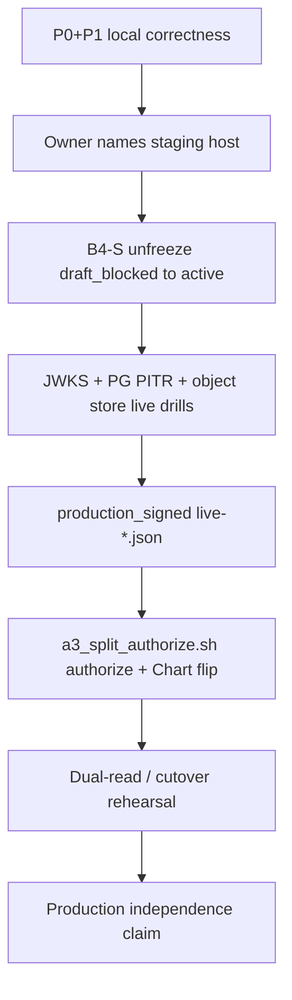

# P2 staging roadmap — after P0/P1 local correctness

> **入口**：本页是「从今天到 Chart 可翻 / 生产独立宣称仍禁止」的总览。  
> **Honesty**：脚手架 ≠ staging live ≠ 生产独立。`ready_to_authorize` 必须保持 false，直到 live 证据齐。  
> **前置收口**：P0 HTTP/`eval_protocol` 正确性 · P1 composite v1.2 · [`STORE_SURFACE_V0.md`](./STORE_SURFACE_V0.md) · [`G2B_RE_REVIEW_PROCEDURE.md`](./G2B_RE_REVIEW_PROCEDURE.md)

## 一句话现状（2026-11-15 机读核对）

| 信号 | 值 | 含义 |
|------|-----|------|
| ADR-EVALUATION-A3 | Accepted（有条件） | 路径批准，不是生产已拆 |
| `a3_prep_check.sh` | `auto_prep_green=true` · `process_split_authorized=false`（脚本口径） | 本机预备绿 |
| `a3_split_authorize.sh status` | `ready_to_authorize=false` · `all_green=false` | **禁止** `authorize` / 翻 Chart |
| SPLIT_CHECKLIST #1/#4 | 🟨 | 本地演练 ≠ live |
| SPLIT_CHECKLIST #2/#3/#5 | ✅ | Chart 骨架 / API 边界 / ADR |
| 政策文档 `process_split_authorized` | 部分文档写 true（owner 覆盖） | **≠** Chart runtime；Chart 仍 `false` |
| B4-S unfreeze | `draft_blocked` | 独立 host **未确认** |
| 最新 live 证据 | `environment=scaffold` · `production_signed=false` | 不算 staging |

刷新命令：

```bash
bash packages/aiplat-evaluation/scripts/a3_prep_check.sh
bash packages/aiplat-evaluation/scripts/a3_split_authorize.sh status
```

## 阶段闸门（必须按序）



任一跳过 = 停。

## 清单（可勾选）

### A — 已完成（本机 / 文档；不授权）

- [x] P0：platform `response_model` / shim / module docs gate
- [x] P1：composite v1.2 弱代理 · store 诚实面 · gate 枚举 · G2b 改判规程
- [x] 本机 B4-S Docker rehearsal（≠ staging）— [`B4S_LOCAL_REHEARSAL.md`](./B4S_LOCAL_REHEARSAL.md)
- [x] B4-S staging **脚手架** + unfreeze **草稿** — [`ENGINEERING_UNFREEZE_EVAL_A3_B4_STAGING.md`](../../../../reports/products/five-products/ops/ENGINEERING_UNFREEZE_EVAL_A3_B4_STAGING.md)
- [x] Chart 骨架存在且 `a3_process_split_authorized=false`

### B — 阻塞在你（治理 / 主机；代码无法代劳）

| # | 决策 / 交付物 | Owner | 退出判据 |
|---|---------------|-------|----------|
| B1 | 指名**独立** staging host（FQDN/集群；非开发本机） | 运维 × 产品 | unfreeze 可从 `draft_blocked` → `active` |
| B2 | staging 网络与 prod Central DB 隔离确认 | 运维 | 写入 B4S 模板 `host_id` + 隔离说明 |
| B3 | JWKS IdP 从 staging 可达 | 安全 / 运维 | 探活证据进 `drills/` |
| B4 | Eval PG + PITR / base backup 窗口 | 运维 | restore drill 计划有日期 |
| B5 | 对象存储（MinIO/S3）桶与凭证 | 运维 | 写入证据路径；**仍无** `payload_uri` 生产宣称（v0=payload_json） |
| B6 | 谁签 `production_signed`、谁跑 `authorize` | 架构 × 业务 | 写进 unfreeze 页 |

详见主机前置：[`B4S_PREP.md`](./B4S_PREP.md) · 预备板：[`PHASE2_STAGING_PREP.md`](./PHASE2_STAGING_PREP.md)

### C — host 确认后的工程动作（仍禁止对外宣称生产独立）

| # | 动作 | 证据 | 禁止 |
|---|------|------|------|
| C1 | 激活 B4-S unfreeze（`status=active`） | ops 解冻页 | 无 host 却标 staging |
| C2 | 填脚手架模板 → `environment=staging` 演练包 | `b4s_staging_scaffold_emit.py` + live JSON | 把 scaffold JSON 改签为 production |
| C3 | JWKS + PG backup/restore + 对象存储 live | `docs/a3/drills/live-*.json` | 本机 Docker 证据冒充 staging |
| C4 | Central 停机依赖矩阵验收 | [`EVAL_RUNTIME_CONTRACT.md`](../../../../docs/architecture/plans/EVAL_RUNTIME_CONTRACT.md) | 跳过 fail-closed 沙箱 |
| C5 | SPLIT_CHECKLIST #1/#4 🟨→✅（**live**） | checklist + prep_check | 仅靠 local rehearsal 改 ✅ |
| C6 | `a3_split_authorize.sh authorize` + Chart flip | chart annotation true | `ready_to_authorize=false` 时强翻 |
| C7 | dual-read / 回滚切回共宿 | runbook 记录 | 未 PITR 就做生产 dual-read |

### D — 明确不在本阶段

- 翻产品 `accuracy_claim`
- microVM / Darwin 隔离认证
- 生产在线评测闭环（那是 **P3**；见下方）
- 把 standalone store 扩成 8 实体全量 CRUD（Central 仍为维护 UI SSOT，见 STORE_SURFACE）

## 与 P3（在线评测）的边界

| | P2 | P3 |
|--|----|----|
| 目标 | 评测**服务**独立部署可授权 | 对**生产产物**持续抽样/漂移 |
| 卡点 | staging host + live 签 | 数据边界（采哪些 trace、脱敏、驻留、告警人） |
| 现有线索 | B4-S / SPLIT / Chart | charter §12.4；`prod_live_baseline.sh` 仅预演 |

P3 设计文档尚未单独立项；**不要**在 P2 未过时把生产 trace 采样接到发布门禁。

## Owner 最小回复模板（解除 B 阻塞）

复制填写后贴回会话或解冻页：

```text
staging_host_id: <FQDN or cluster>
network_isolation_from_prod_central_db: yes|no
jwks_issuer_url: <url>
eval_pg_dsn_reachable: yes|no
object_store_endpoint: <url>
pitr_drill_window: <date>
authorize_signer: <name/role>
unfreeze_action: set ENGINEERING_UNFREEZE_EVAL_A3_B4_STAGING status=active
```

## 相关索引

| 文档 | 角色 |
|------|------|
| [`SPLIT_CHECKLIST.md`](./SPLIT_CHECKLIST.md) | 硬门五项 |
| [`PHASE2_STAGING_PREP.md`](./PHASE2_STAGING_PREP.md) | staging 预备板 |
| [`B4S_PREP.md`](./B4S_PREP.md) / [`B4S_RUNBOOK.md`](./B4S_RUNBOOK.md) | 主机前置 / 操作 |
| [`B4S_STAGING_SCAFFOLD.md`](./B4S_STAGING_SCAFFOLD.md) | 脚手架 |
| [`PHASE3_PROCESS_SPLIT_AUTHORIZE.md`](./PHASE3_PROCESS_SPLIT_AUTHORIZE.md) | 政策旗标说明（≠ Chart） |
| [`ADR-EVALUATION-A3.md`](../../../../reports/five-products/ADR-EVALUATION-A3.md) | 有条件 Accepted |
| [`EVAL_RUNTIME_CONTRACT.md`](../../../../docs/architecture/plans/EVAL_RUNTIME_CONTRACT.md) | 运行时契约 / 停机矩阵 |
